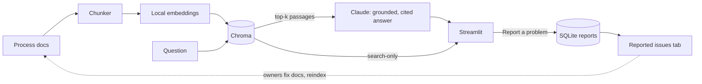

# Ops Knowledge Assistant

A RAG assistant for internal operations teams. It answers questions from process documents with citations, says so when the documents don't contain the answer, and lets employees report answers that are wrong or out of date. Those reports become a backlog for fixing the documentation.

> Built end to end as a forward-deployed engineering exercise. I was both the customer and the solutions architect. The problem comes from my own experience at past roles. The knowledge base is a synthetic healthcare claims-operations set (X12 837 intake, acknowledgments, defect triage, release gates, reconciliation, AI governance). It contains no real patient, customer or employer data.

## The problem

In several roles I saw operations teams lose time to the same documentation problems:

- **Scattered:** the steps for one task are spread across runbooks, wikis and team folders.
- **Out of date:** documents outlive the processes they describe, and nothing marks them as stale.
- **Gaps:** documents refer to steps or other documents that don't exist.
- **No way to report problems:** when someone finds an error, nothing captures it, so the next person runs into it too.

A chatbot that answers *fluently* from bad documents makes this worse. The goal was answers people can trust, plus a way to expose and fix the documentation underneath.

## Requirements

| # | Requirement | Why |
|---|---|---|
| R1 | Answers come only from documents, with citations | Users can check before acting |
| R2 | Say plainly when the documents don't cover something | No invented processes, and documentation gaps become visible |
| R3 | Employees can report incorrect, outdated or missing information | Everyday use maintains the documentation |
| R4 | Reports are stored, filterable and exportable | Document owners can act on them |
| R5 | Usable without a terminal | Adoption by non-technical staff |
| R6 | Minimal data leaves the environment | Healthcare-adjacent content; easier security review |
| R7 | Works without the LLM (search-only mode) | Resilience, cost control, debugging retrieval |

## Architecture



| Decision | Choice | Trade-off |
|---|---|---|
| Embeddings | Local `all-MiniLM-L6-v2` | Documents never leave the machine for embedding, at some cost in retrieval quality. Can be swapped behind one function. |
| Vector store | Chroma, stored on disk | No infrastructure to run. Enough for a team-sized document set. |
| LLM | Claude, streamed | Only the question and the top-k passages are sent. The model is configurable. |
| Grounding | Prompt requires `[n]` citations and admitting gaps | Partial or empty answers over confident wrong ones |
| Feedback store | SQLite | Nothing to install. Carries over directly to Postgres. |
| Reindexing | Full rebuild | Removed or edited documents never leave stale passages behind |

## Data quality feedback loop

Every answer has a **Report a problem** form with three fields:
- issue type: Incorrect, Outdated, Missing information or Other
- the affected documents
- a description of what's wrong

Each report stores the exact question, answer and sources the employee saw, so a reviewer can reproduce it. Document owners work through the reports on the **Reported issues** tab (open → in review → resolved or dismissed) and can export them to CSV.

| Report type | Likely cause | Fix |
|---|---|---|
| Outdated | The source document is stale | Owner updates it, then reindex |
| Missing information | A gap in the documents | Write the missing document |
| Incorrect | Wrong document, or retrieval or generation error | Fix the document, or adjust retrieval |

## Evaluation

`python -m rag_app eval` runs the scenario set (KB-008) and checks whether the expected source document is among the top-k retrieved passages. It runs locally and makes no LLM calls.

| Metric | Result |
|---|---|
| Hit@5 | 6/6 |
| Hit@3 | 6/6 |
| Hit@1 | 5/6 (the uptime trick question ranks the governance document 2nd) |

**Answer leakage found and fixed:** the scenario file was originally indexed alongside the documents, and on two questions it ranked **first**, ahead of the real source. That made the score meaningless. It now lives in `eval/`, outside the index, and the eval prints a warning if it ever gets indexed again.

The test set is small: 6 questions over 7 documents. These numbers are a baseline, not a claim of production quality.

12 unit tests cover chunking, loading, feedback storage and validation, and eval scoring.

## Trust and safety

- **Citations and expandable source passages** under every answer. The assistant says what the documents don't cover, including documents that are referenced but missing.
- **Data minimization:** embedding and search run locally, and the LLM sees only the top-k passages.
- **Secrets and data out of git:** the API key, source documents, index and feedback database are all ignored by git.
- **Search-only mode** for debugging retrieval separately from generation, and for when the API is unavailable.

## Run it

```powershell
python -m venv .venv; .venv\Scripts\Activate.ps1
pip install -r requirements.txt; pip install -e .
copy .env.example .env      # add ANTHROPIC_API_KEY
python -m rag_app ingest    # index data/raw
streamlit run app.py        # web UI
python -m rag_app eval      # retrieval eval
pytest
```

```
app.py              Streamlit UI (Ask, Reported issues)
src/rag_app/        loaders · store · generate · feedback · evaluate · config
eval/               Scenario answer key (kept out of the index)
tests/
```

## Roadmap to production

- **Identity:** SSO instead of typed-in names, a record of who changed what, and a reviewer role.
- **Hosting:** a container, a managed vector database and Postgres.
- **Retrieval:** split documents by heading, add reranking, track Hit@k in CI on a larger test set.
- **Freshness:** show each document's version and last-reviewed date in answers, and send reports automatically to each document's owner.
- **Analytics:** most-reported documents and questions the documents couldn't answer, as a prioritized documentation backlog.
